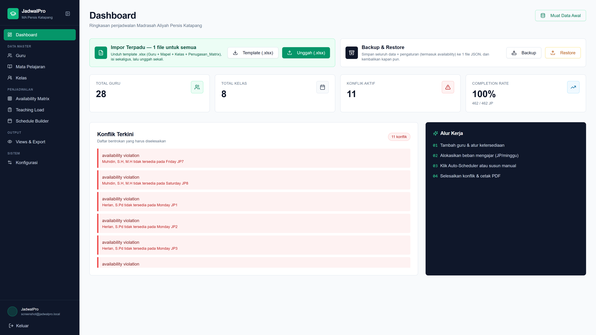
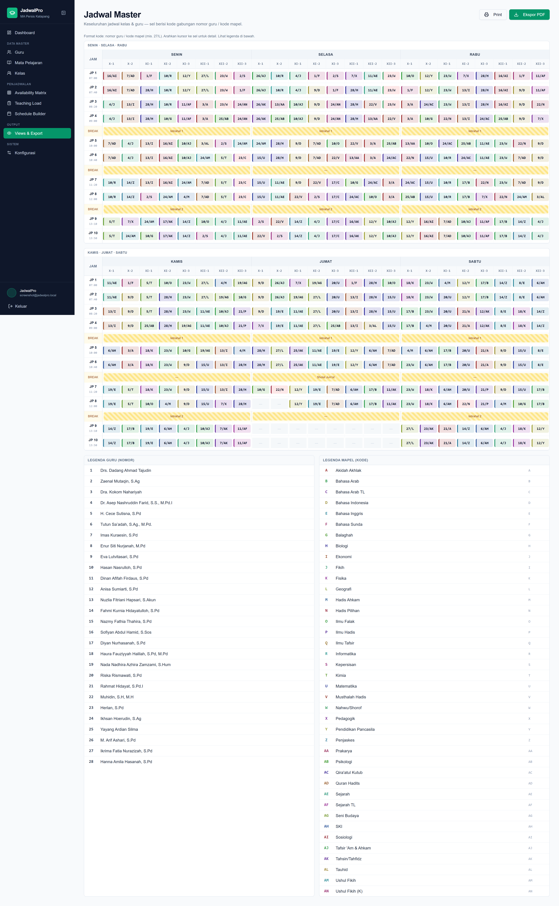
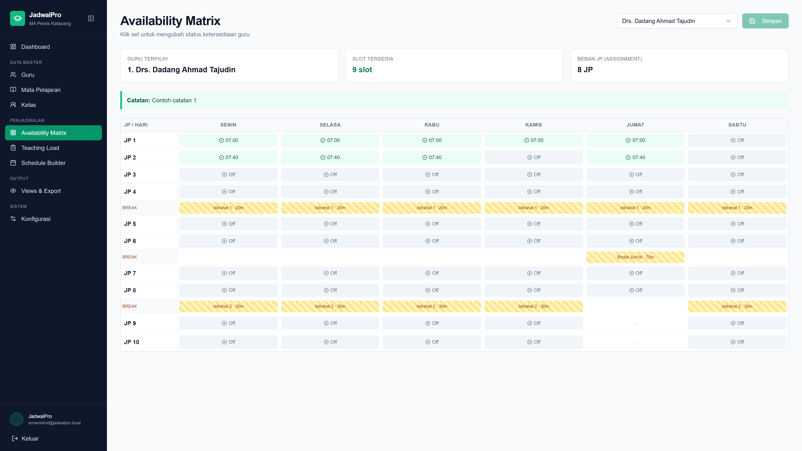

# JadwalPro — EduSchedule AI

Aplikasi web **generator jadwal pelajaran + manajemen konflik** untuk **MA Persis Katapang**.
Menyelesaikan penjadwalan sekolah dengan constraint ketersediaan guru yang kompleks
(mengajar di sekolah lain, batasan setelah Dzuhur, kunci hari/slot, salat Jumat),
dilengkapi auto-scheduler greedy, AI optimizer (OR-Tools CP-SAT), impor terpadu sekali-upload,
backup/restore, dan ekspor PDF.

## Tampilan Aplikasi

| Login | Dashboard |
|---|---|
|  |  |

| Jadwal Master | Availability Matrix |
|---|---|
|  |  |

## Fitur Utama

| Modul | Halaman | Keterangan |
|---|---|---|
| Dashboard | `/dashboard` | 4 kartu statistik, konflik terkini, **Impor Terpadu (.xlsx)**, **Backup & Restore (.json)** |
| Data Guru | `/teachers` | CRUD + **Nomor (PK)** sebagai kode guru; Beban JP dihitung otomatis dari Teaching Load; bulk delete; template CSV |
| Mata Pelajaran | `/subjects` | CRUD, **Kode = PK**, warna dibuat otomatis (golden-angle, kontras); bulk delete; template CSV |
| Kelas | `/classes` | CRUD + **Wali Kelas** (relasi ke guru); bulk delete; template CSV |
| Availability Matrix | `/availability` | Toggle tersedia/tidak per guru per slot; default baru = **off**; peringatan bila slot tersedia < beban JP |
| Teaching Load | `/assignments` | Alokasi guru × mapel × kelas × JP/minggu; bulk delete; template CSV |
| Schedule Builder | `/schedule` | Drag-and-drop per kelas **atau mode Master semua kelas (kode `noGuru/kodeMapel`)**, blok otomatis 2–3 JP berurutan, Auto-Scheduler, Rebuild, **AI Optimizer**, filter kode (maks 5), panel sembunyi |
| Views & Export | `/views` | Jadwal Master 2 band × 3 hari + legenda nomor/kode, highlight konflik merah, ekspor PDF + Print |
| Konfigurasi | `/config` | Durasi JP/istirahat per hari (termasuk khusus Jumat), **batas JP per kelas** (mis. Jumat X-1/X-2 = 7 JP), Zona Berbahaya (hapus semua data) |

Aturan bisnis penting:

* **Blok berurutan** — mapel > 1 JP per kelas wajib dalam blok 2/3 JP sehari (4→2+2, 5→3+2), tidak menyeberangi istirahat, tidak berdempetan menjadi run > 3.
* **Tanpa sisa, tanpa bentrok diam-diam** — sisa JP yang tak muat bersih tetap dipasang dengan pelanggaran minimal dan otomatis **merah + tooltip sebab**; input manual yang bentrok guru ditolak (409).
* **Jumat khusus** — konfigurasi mendukung batas JP per kelas (default seed: X-1/X-2 = 7 JP).

## Tech Stack

**Backend** (`backend/`)

* Python 3.14, **FastAPI** + Uvicorn, **MongoDB** (Motor async)
* **OR-Tools CP-SAT** — AI optimizer penjadwalan (eksak, terbukti optimal)
* `openpyxl` (template/impor `.xlsx`), `pandas`/`numpy`, `python-multipart`
* Auth: Google OAuth via Emergent (`POST /api/auth/session` → cookie `session_token`)

**Frontend** (`frontend/`)

* React 19 + CRA + Craco, React Router 7, Tailwind CSS 3 + Shadcn/Radix UI
* `@dnd-kit` (drag-and-drop jadwal), `jspdf` + `jspdf-autotable` (ekspor PDF)
* `axios`, `sonner` (toast), `lucide-react` (ikon)

**Database** — MongoDB `jadwalpro` (koleksi: `teachers`, `subjects`, `classes`,
`assignments`, `schedule`, `day_configs`, `users`, `user_sessions`).
Kredensial lokal: `mongodb://localhost:27017` tanpa auth (lihat `backend/.env`).

## Struktur Repo

```
JadwalPro/
├── backend/
│   ├── server.py          # seluruh API (FastAPI, ±2500 baris)
│   ├── requirements.txt
│   ├── pytest.ini         # pytest + xdist (2 worker, loadscope)
│   └── .env               # MONGO_URL, DB_NAME, backend URL
├── frontend/
│   ├── src/
│   │   ├── pages/         # Dashboard, Teachers, Subjects, Classes,
│   │   │                  # Availability, Assignments, ScheduleBuilder,
│   │   │                  # Views, Config, Login
│   │   ├── components/    # Layout (sidebar lipat), ui/ (Shadcn)
│   │   └── lib/           # api.js, scheduleConfig.js, conflicts.js, constants.js
│   └── package.json       # packageManager: yarn
├── memory/PRD.md          # ringkasan produk & backlog
├── tests/                 # uji backend
├── test_reports/          # laporan & runner pengujian
└── design_guidelines.json # sistem desain (Emerald/Slate, data-testid, dsb.)
```

## Menjalankan Lokal

Prasyarat: Python 3.14 + `venv`, Node + Yarn, MongoDB berjalan di `localhost:27017`.

**1. Backend**

```powershell
cd backend
.\venv\Scripts\Activate.ps1
python -m pip install -r requirements.txt
uvicorn server:app --reload --port 8000
```

**2. Frontend**

```powershell
cd frontend
yarn install
yarn start
```

Buka `http://localhost:3000` (login Google, lalu `/dashboard`).
Isi `frontend/.env` bila backend tidak di `http://localhost:8000`:

```
REACT_APP_BACKEND_URL=http://localhost:8000
REACT_APP_API_URL=http://localhost:8000
```

**3. Data awal** — klik **Muat Data Awal** di Dashboard (`POST /api/seed`),
atau unggah **Template Terpadu (.xlsx)** dari Dashboard (1 file untuk
Guru + Mapel + Kelas + matriks Penugasan), lalu klik **AI Optimizer** di Schedule Builder.

## Ringkasan API (`/api`)

* Auth: `POST /auth/session`, `GET /auth/me`, `POST /auth/logout`
* CRUD + `POST /{teachers,subjects,classes,assignments}/bulk-delete`
  + `GET /.../template` & `POST /.../upload` (CSV)
* Impor terpadu: `GET /import/template.xlsx`, `POST /import/workbook`
* Backup/restore: `GET /backup`, `POST /restore`, `POST /reset-all`, `POST /seed`
* Jadwal: `GET|POST /schedule` (validasi 409 + `?force=true`),
  `POST /schedule/auto`, `/schedule/rebuild`, `/schedule/optimize?time_limit=120`,
  `GET /schedule/conflicts`, `POST /schedule/clear`
* Konfigurasi hari: `GET /day-configs`, `PUT /day-configs/{day}` (termasuk `class_limits`), `POST /day-configs/{day}/reset`
* Dashboard: `GET /dashboard/stats`

## Pengujian

```powershell
cd backend
.\venv\Scripts\Activate.ps1
pytest            # sesuai pytest.ini (xdist 2 worker)
```

## Catatan

* Scheduler greedy menghormati occupancy + availability + blok 2/3 JP;
  AI Optimizer (CP-SAT, ~2 menit untuk ±460 JP) menjamin semua JP terpasang
  dengan pelanggaran minimal yang terbukti optimal.
* Semua tombol/fitur interaktif memakai `data-testid` (lihat `design_guidelines.json`).
* Riwayat pengembangan: `git log --oneline`; konteks produk: `memory/PRD.md`.
